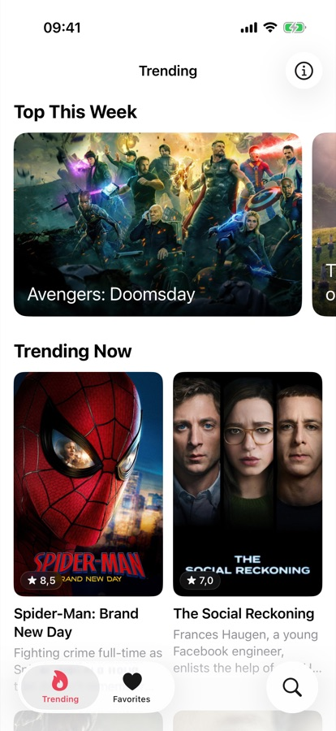
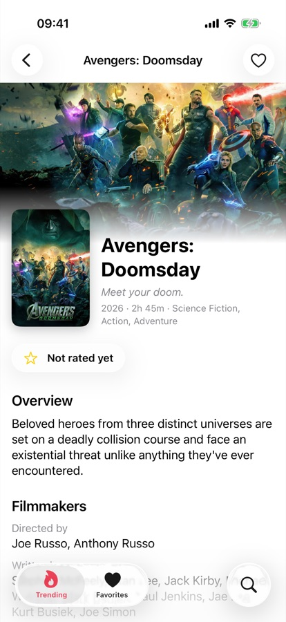
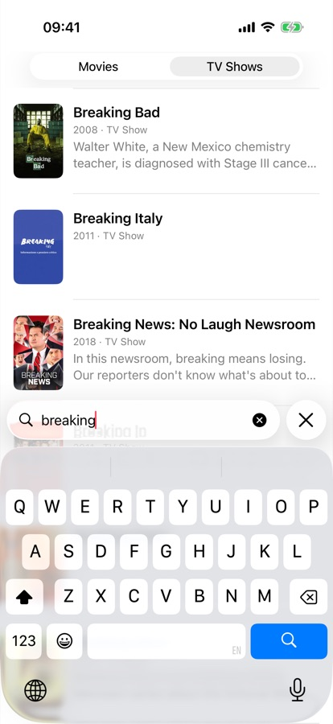
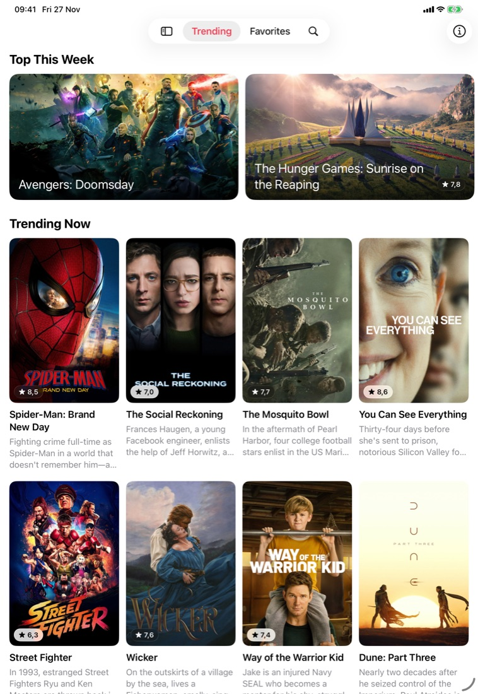
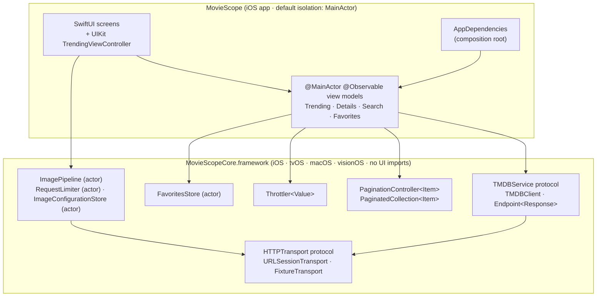

# MovieScope

An iPhone and iPad app for browsing trending movies, searching movies and TV
shows, and keeping local favorites, built on [The Movie Database (TMDB)](https://www.themoviedb.org) API.

- **SwiftUI** app with a **UIKit** collection view for the Trending screen
- **Swift 6** strict concurrency
- **MVVM**
- A multi-platform **`MovieScopeCore`** framework (iOS, tvOS, macOS, visionOS)
- Native `URLSession` networking
- XCTest at **95% coverage** on the framework

| Trending | Details | Search | iPad |
|---|---|---|---|
|  |  |  |  |

## Contents

- [Getting started](#getting-started)
- [Features](#features)
- [Architecture](#architecture)
- [Concurrency](#concurrency)
- [Networking, images and caching](#networking-images-and-caching)
- [Environments, schemes and secrets](#environments-schemes-and-secrets)
- [Testing](#testing)
- [XCFramework](#xcframework)
- [Accessibility, adaptivity and older iOS versions](#accessibility-adaptivity-and-older-ios-versions)
- [Known limitations and next steps](#known-limitations-and-next-steps)
- [Project documents](#project-documents)

## Getting started

**Requirements:** Xcode 26.6 or later (built and tested with Xcode 26.6, Swift 6.3), and iOS/iPadOS 18.0 or later.

1. Copy `Config/Secrets.example.xcconfig` to `Config/Secrets.xcconfig`. The copy is gitignored.
2. Paste your TMDB **API Read Access Token** as the value of `TMDB_ACCESS_TOKEN`. You can find it at themoviedb.org → Settings → API.
3. Open `MovieScope.xcodeproj`, pick the **MovieScope Dev** scheme and run.

Notes:

- **No token:** the project still builds and every test passes; the app shows setup instructions instead of content.
- **SwiftLint:** on the first build Xcode asks you to **Trust & Enable** the SwiftLint build-tool plugin. Command-line builds need `-skipPackagePluginValidation -skipMacroValidation`.
- **Test data mode:** set `MOVIESCOPE_FIXTURES=1` in the scheme to run the app on bundled TMDB responses, with no network and no token.

## Features

| Brief | Implementation |
|---|---|
| Trending movies in a collection view with a custom layout | `UICollectionView` with a custom compositional layout. A featured row of backdrop cards pages sideways; below it, a self-sizing poster grid fits as many columns as the width allows (2 on iPhone portrait, 4–7 on iPad). |
| Infinite scrolling | `PaginationController`. The next page loads 6 items from the end. Overlapping pages are de-duplicated by identity, only one request runs at a time, a failed page offers a retry, and paging stops at TMDB's 500-page limit. |
| Title, image and short description | Each card shows the poster, rating badge, title (2 lines) and overview (3 lines). |
| Details screen with extended content | A scrollable SwiftUI screen for **movies and TV shows**:<br>• backdrop, poster, tagline, year, runtime or seasons/episodes, genres<br>• rating and vote count<br>• overview<br>• directors and writers (movies) or creators (TV): the brief's "authors"<br>• cast<br>• up to 3 reviews with their authors<br>• status, language, budget/revenue or networks |
| Search movies and series, kind chosen in advance, throttleable | `.searchable` with a **Movies / TV Shows** scope that is shown as soon as search opens. Queries are **throttled**: the first fires immediately, then at most one per 400 ms, always ending with the latest text. Older requests are cancelled and their late responses dropped. |
| Images fetched based on view size | Every image requests the smallest TMDB size at least as wide as its **rendered pixel width** (points × screen scale), then is downsampled to exactly that size. |
| Bonus: local favorites with an indicator | Heart in Details, a badge on cards and search rows, a long-press menu on Trending, and a Favorites tab. Stored in a JSON file owned by an actor; works offline. |
| Bonus: pre-cache via concurrent/queued download | Collection view prefetching feeds the image pipeline, which allows at most 6 downloads at once (`RequestLimiter`). |
| Bonus: low-res image before the final one | Details shows the poster already cached from the grid instantly, then cross-fades to the full-size image. |
| Bonus: image caching | Decoded images in an actor-owned memory cache, plus a dedicated `URLCache` on disk (20 MB memory, 200 MB disk). |
| Bonus: `.xcframework` core | `Scripts/build-xcframework.sh` builds `MovieScopeCore.xcframework` with 7 slices (see [XCFramework](#xcframework)). |
| Bonus: offline mode | Partial: favorites and cached images work offline. The rest is deferred; the planned design is under [next steps](#known-limitations-and-next-steps). |

The About screen shows the TMDB logo and the attribution notice required by TMDB's terms.

## Architecture



**Pattern: MVVM with constructor injection.**
- View models depend on protocols (`TMDBService`, `HTTPTransport`, `FavoritesStoring`, `Sleeper`), never on concrete types.
- One composition root wires everything; tests pass in fakes. No DI library.

**Access control.**
- `MovieScopeCore` exposes a small `public` surface.
- DTOs, mapping, endpoints and helpers are `internal`; tests reach them with `@testable import`.

**Generics.**
- `Endpoint<Response>` ties a request to its decoded type.
- `Page<Item>`, `PaginatedCollection<Item>` and `PaginationController<Item>` are shared by Trending and Search.
- `Throttler<Value>`.

**Protocol-oriented seams.**
- Transport: live, fixture and fake implementations.
- Credentials: environment, bundle and static providers, plus a chain that tries them in order.
- Sleeping: real or controlled in tests.
- Storage: file-backed or in-memory.

## Concurrency

Every target uses Swift 6 language mode, so data-race safety is checked at compile time.

**App target:**
- Default actor isolation is `MainActor`, with Approachable Concurrency on (Apple's recommendation for app modules).
- Pure helpers are explicitly `nonisolated`.

**Core target:**
- Default isolation is `nonisolated`; SE-0466 says `MainActor` is the wrong default for libraries.
- `NonisolatedNonsendingByDefault` stays off, so Core's async APIs never run on the caller's actor implicitly.

**Shared mutable state lives in actors:**
- `ImagePipeline`
- `RequestLimiter`
- `ImageConfigurationStore`
- `FavoritesStore`

**Heavy work runs off the actors.** JSON decoding and ImageIO downsampling run in `nonisolated` code, and downloads start in `Task { @concurrent … }`.

**No escape hatches.** There is no `@unchecked Sendable`, no `nonisolated(unsafe)` and no lock-wrapped boxes. `NSCache` isn't `Sendable`, so it never leaves its actor. Test-only shared state uses `Synchronization.Mutex`.

**Cancellation is end to end:**
- Leaving a screen cancels its work (`.task`).
- Reused cells cancel their image loads.
- The last caller giving up on an image cancels its download.
- A new search cancels the previous one.

## Networking, images and caching

**TMDB client:**
- `TMDBClient` sends the Read Access Token as a Bearer header and adds `language=en-US` to every request.
- It percent-encodes query values strictly (`Amélie & Co`, `東京` and `+` survive).
- It maps every failure to `APIError`.
- It retries an HTTP 429 once.

**DTO mapping** absorbs TMDB's quirks: empty date strings, `0` meaning "unknown", the same person credited for several jobs.

**Identity:** titles are identified by `(kind, id)`, because movie and TV ids are separate namespaces.

**Images:**
- **Size selection:** `ImageSizeSelector` picks the smallest `wNNN` size at least as wide as the rendered pixels. It ignores height-based tokens (`h632`) and never picks `original`. Size lists come from `/configuration`, cached for 7 days, with a built-in fallback.
- **De-duplication:** concurrent requests for the same image share one download.
- **Prefetching:** prefetches use the exact size cells render at, so they hit the same cache entries.
- **Reused cells:** cancellation plus a key check stop a slow image from landing in a reused cell.

## Environments, schemes and secrets

**Configurations:**
- **Dev:** debug build, `.dev` bundle id suffix, "MovieScope Dev", verbose logging.
- **Prod:** optimised release build.
- Both talk to the same live TMDB API; TMDB has no staging server. Settings live in `Config/*.xcconfig`.

**Shared schemes:**
- `MovieScope Dev`: Run and Test with Dev.
- `MovieScope Prod`: Run, Profile and Archive with Prod.
- `MovieScopeCore`: Core tests and the XCFramework script.

**Environment variables in the Dev scheme.** None of them are secrets:

| Variable | Default | Effect |
|---|---|---|
| `MOVIESCOPE_LOG_LEVEL` | on (`debug`) | Log verbosity |
| `MOVIESCOPE_FIXTURES` | off | Use bundled test data instead of the network |
| `MOVIESCOPE_RESET_STATE` | off | Wipe favorites and cached configuration at launch |

Dev builds also accept a `TMDB_ACCESS_TOKEN` environment variable, from a local unshared scheme.

**Secrets.**
- The token lives in the gitignored `Config/Secrets.xcconfig`, which is included optionally, so a clean checkout builds without it.
- At build time it is injected into Info.plist. It never appears in a shared scheme, and the `Authorization` header is redacted in logs.
- **Threat model:** any token shipped inside an app can be extracted from the binary. That is acceptable for a read-only public-data key. The production answer is a small backend proxy that holds the key, not obfuscation (see `docs/DECISIONS.md`).

## Testing

| Target | Tests | What they cover |
|---|---|---|
| `MovieScopeCoreTests` | 108 | Networking (URL building, encoding, status mapping, retry, cancellation, URLSession via a `URLProtocol` stub), decoding of captured TMDB fixtures, DTO mapping edge cases, pagination, throttling, image sizing/configuration/pipeline/limiter, favorites persistence |
| `MovieScopeTests` | 57 | View models (Trending, Details, Search including stale first and next pages, Favorites), layout math, snapshot building, formatters, composition root |
| `MovieScopeUITests` | 10 | Trending with page 2 and rotation, details, search with scope switch, favorites, setup screen, attribution, largest Dynamic Type, and one **recorded** flow |

- **Coverage:** **95% line coverage on `MovieScopeCore.framework`**. `./Scripts/coverage.sh` runs the unit tests and fails below 80%.
- **Async tests** use `await fulfillment(of:)`.
- **Inverted expectations** check things that must *not* happen: a stale result applied, a throttled call sent.
- **Determinism:** time-based logic is driven by a controllable `Sleeper` (`TestSupport/ControlledSleeper.swift`) instead of real delays.
- **UI tests** run on bundled fixtures (captured with `Scripts/capture-fixtures.sh`, artwork generated in code), so they need no network or token. Verified on iPhone 17 Pro (iOS 26.5), iPhone 16 (iOS 18.6) and iPad Pro 11".
- **The recorded flow** (`RecordedFlowUITests`) was captured with Xcode 26's UI test recorder. The raw recording is in the git history. It was then edited to use stable identifiers, drop incidental gestures and add assertions.

**Test plans:**
- `CoreTests`: framework tests and framework coverage.
- `UnitTests`: Core and app unit tests.
- `UITests`.

## XCFramework

```bash
./Scripts/build-xcframework.sh            # all 7 slices → Artifacts/MovieScopeCore.xcframework
./Scripts/build-xcframework.sh -P ios,ios-simulator,macos
```

- **Slices:** iOS, iOS Simulator, tvOS, tvOS Simulator, macOS, visionOS and visionOS Simulator.
- **Built for distribution:** each slice is built with `BUILD_LIBRARY_FOR_DISTRIBUTION=YES`.
- **Fails loudly:** the script stops if any slice is missing its `.swiftinterface`, because without it apps can't `import` the framework.
- **Not committed:** the artifact is gitignored.

## Accessibility, adaptivity and older iOS versions

- **Dynamic Type everywhere.** At accessibility sizes the grid switches to one column and the details header stacks vertically. A UI test renders both screens at the largest size.
- **VoiceOver:** cards read as "Title, rated 7.8 out of 10, favorite"; section titles are headers; images are decorative.
- **iPhone and iPad, portrait and landscape:**
  - The tab bar becomes a sidebar or top bar on iPad.
  - The grid adapts its columns to any width.
  - The details header goes side by side in regular width.
  - Search pins its field and scopes on iPad.
- **iOS 18 minimum, iOS 26 features gated.** Liquid Glass (`glassEffect` in SwiftUI, `UIGlassEffect` in UIKit) falls back to materials and blur on iOS 18–25. Both paths are tested on the iOS 18.6 and 26.5 simulators.

## Known limitations and next steps

**Offline mode for Trending, Details and Search is deferred** to protect the core scope within the time-box. Favorites and already-cached images work offline today. The planned design:

1. Persist the last fetched trending pages and opened details as timestamped JSON snapshots, keyed by request.
2. When a request fails for connectivity reasons, serve the snapshot and show a "Showing saved results from …" banner.
3. Purge snapshots after 30 days. TMDB's terms cap caching TMDB content at 6 months.
4. Keep search online-only, with a clear offline message.

**Smaller items:**
- **Fixture details data:** in test data mode every movie opens the same details fixture (and every TV show the same TV fixture).
- **Image cache retention:** the image disk cache honours TMDB's long CDN cache headers. A production app would also enforce the 6-month retention limit.
- **The token is embedded in the app.** A backend proxy is the production path.

## Project documents

- `docs/DESIGN.md`: requirements traceability, constraints, approaches considered.
- `docs/DECISIONS.md`: dated decision log.

---


This application uses TMDB and the TMDB APIs but is not endorsed, certified, or otherwise approved by TMDB.
